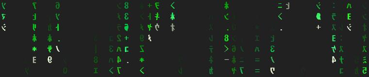

# digital-rain

A mod for [Claude Code](https://claude.com/claude-code): while Claude works on your prompt,
green digital rain falls in the band above the prompt. When the turn ends, the band switches
off like an old CRT television and slides closed.



- **Film-style rain.** As in the film, the glyphs (mirrored half-width katakana, digits and a
  few symbols) stay put and only the light moves: each column has a pale cream head and a long,
  uneven green tail, with its own speed, trail length and tint.
- **Smooth and cheap.** On the desktop app the rain is a single SVG that the app animates by
  itself, with no per-frame work by the mod. The picture changes only ten times a second, on
  one shared clock, so the browser has nothing to repaint in between (about 8× less CPU than
  0.3). In a terminal it is a monospace text rain.
- **A soft ending.** The picture squashes into a bright line, the line pinches into a glowing
  dot that lingers for a blink, then the band slides closed so the chat doesn't jump.
- **No tokens.** The mod never calls the model, adds nothing to the conversation or the system
  prompt, and makes no network requests. It costs a little local CPU while it rains, nothing more.

## Install

You need a Claude Code version with mod (plugin hooks) support. In a terminal:

```bash
claude plugin marketplace add MarkusDuskanich/digital-rain
```

```bash
claude plugin install digital-rain@digital-rain --scope user
```

Then start a new session, in the desktop app or the terminal. `claude plugin list` shows
`digital-rain@digital-rain` as enabled. To remove it:

```bash
claude plugin uninstall digital-rain@digital-rain
```

If your organization's settings block plugins, the install is refused.

## Command

| Command | What it does |
|---|---|
| `/digital-rain on` | Rain all the time, between turns too |
| `/digital-rain off` | Back to the default: rain only while Claude works |
| `/digital-rain` | Toggle between the two |

The choice is saved and outlasts restarts. The default is off (rain only while Claude works).

## Tuning

Clone the repo, change the constants at the top of `hooks/svg-rain.ts`, and install from your
clone (`claude plugin marketplace add <path to your clone>`):

| Constant | What it sets |
|---|---|
| `TRAIL_MIN`, `TRAIL_MAX` | rows lit behind a drop's head |
| `HEAD_COLOR` | the head's colour |
| `FLICKER_CHANCE` | share of cells that flicker between two glyphs (0 = none) |
| `DIM_CHANCE` | share of glyphs drawn dimmer than their neighbours |
| `SVG_ROWS`, `ROW_HEIGHT` | the band's height |
| `TICK_SECONDS` | the shared clock; more ticks a second fall faster and cost more CPU |
| `TICKS_PER_ROW` | the speed groups, in ticks per row a drop falls |

Keep `TICK_SECONDS` a multiple of a millisecond, so the speed groups stay in step.

## How it works

- `hooks/register.tsx` hooks the start and end of each turn, draws the band above the prompt
  (`ui.render` on `AbovePrompt`) and serves the `/digital-rain` command.
- `hooks/svg-rain.ts` builds the desktop rain and the switch-off as SVG with SMIL animation.
  The glyphs are a fixed mask and only the light behind them moves: each speed group's
  trails are one tall drawing that a loop of SMIL `<set>`s moves down a row per step. A
  running animation makes the browser repaint every frame of the display, while a `<set>`
  wakes it only when it starts or ends, so between ticks nothing is drawn at all.
- The desktop reloads an SVG whenever its source or size changes, so the rain's source stays
  fixed for a whole turn, the switch-off is a second SVG that plays by itself, and the closing
  shrinks an empty drawing.

Check and test a clone with:

```bash
claude plugin validate <path to your clone>
```

```bash
claude plugin test <path to your clone>
```

Measure what the rain costs (Windows, Microsoft Edge, Node): render it, then time it in a
private Edge window that draws it as the desktop does. Keep the window visible while it runs.

```bash
node bench/render.js hooks/svg-rain.ts bench/rain.svg 1400
```

```bash
powershell -ExecutionPolicy Bypass -File bench/bench.ps1 -Svg rain.svg
```

## Notes

The band background colour used by the switch-off is tuned for the desktop app's dark theme.

Inspired by the digital rain of *The Matrix*. Not affiliated with Anthropic or Warner Bros.

## License

[MIT](LICENSE)
